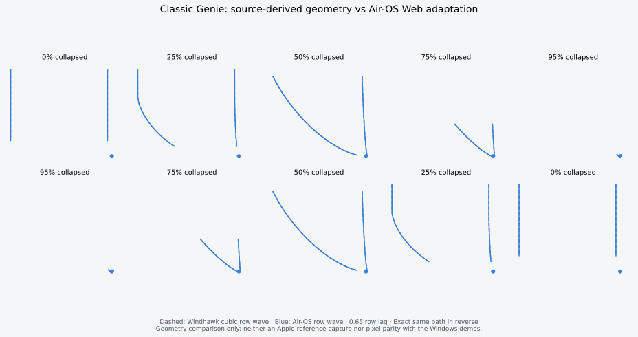
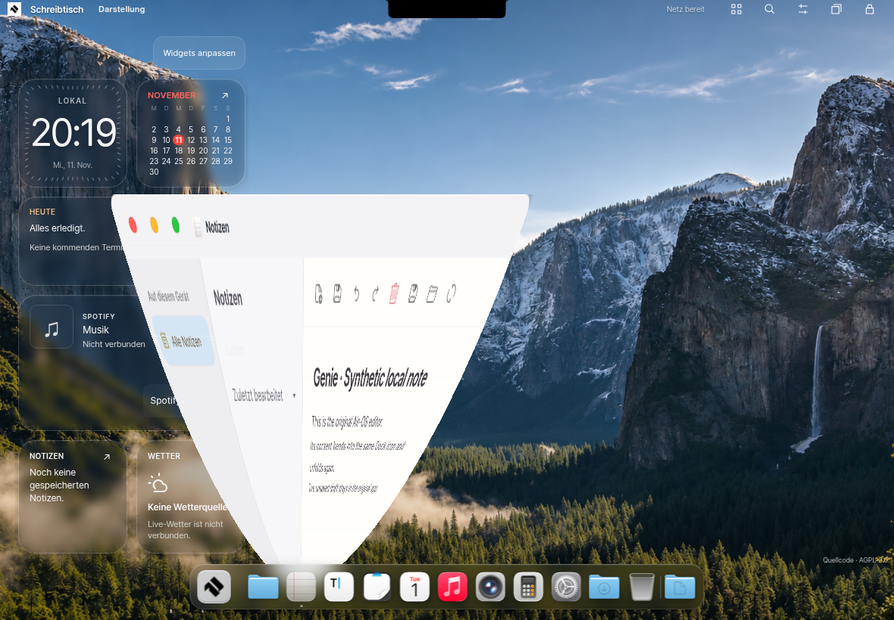

# Classic Genie for Air-OS iPad

This work is stacked on PR #5 (`feat/air-flow-motion-glass`, base `3c244ff`).
It changes window minimization/restoration, not the desktop design. Wallpaper,
icons, Dock styling, widgets, lockscreen, cover/clock stacking and Pro Notch
presentation remain the PR #5 versions. No deployment or PC repository changes.

## Reference analysis and choice

The Windhawk Windows Animations source was inspected at
`b54d0b4fdde083aa1d4e4e708a17153288a2e114`:
https://github.com/ramensoftware/windhawk-mods/blob/b54d0b4fdde083aa1d4e4e708a17153288a2e114/mods/windows-animations.wh.cpp

Its published MIT Genie uses a row-dependent wave with a 0.65 delay spread,
cubic Hermite easing, a narrow terminal neck and a default 360ms duration.
The lower edge starts first; the upper edge follows later. Its GPU implementation
is a two-vertex strip across rows. Restore evaluates the same deformation in
reverse. The last 20% also reduces opacity; this accompanies real deformation.

Both GIFs in https://github.com/Potassiumuncher/MacOS-Animation-for-windows
were inspected, as was the explicit `genie_preview.gif` linked by Windhawk.
The July GIF shows the characteristic long, curved funnel. The August GIF
also demonstrates other distortions and is not treated as a single canonical
Genie trace. No GIFs, screenshots, binaries or proprietary Apple implementation
are bundled in the PWA. Reference URLs/hashes are in `docs/testing/genie/reference.json`.

`core/genie-model.js` adapts the MIT row-wave formula and timing to a bottom
floating Dock. Upstream attribution and the MIT permission text are appended to
`ipad/NOTICE`; all prior NOTICE bytes are retained. Projection, browser snapshots,
resource management and integration are new Web code.

The implementation uses **16 or 24 projectively transformed DOM strips**.
A rectangle-to-trapezoid homogeneous matrix maps each clipped source row to the
curve. This is actual nonuniform geometry, not a uniform scale/zoom approximation.
One-pixel source overlaps cover rasterization cracks between neighboring strips.

WebGL2 was considered: it can deform a texture efficiently, but Safari has no
standard API to obtain the texture of arbitrary live HTML. SVG foreignObject
rasterization can fail/taint canvas in WebKit, and a DOM painting library would add
another, approximate renderer. Local inert DOM strips retain the browser's text,
controls and image rendering without a screenshot service or native permissions.
They cost more DOM preparation than a native texture; that limit is measured and
reported rather than hidden.

## Content and lifecycle

- A bounded, transient clone freezes computed layout/text, input/textarea values,
  selected options and scroll offsets, and retains loaded image resources. Animated
  image resources may continue their own animation. Canvases and
  ready video frames become local raster images; audio is never duplicated.
- Presentation copies have no IDs, form names, inline handlers or authoritative
  app/window identity. They are inert, aria-hidden and pointer-transparent.
  The original app remains the sole state/data owner. A completed restore also
  restores keyboard focus when that app is still active, without stealing focus
  from another app or an open dialog.
- Row matrices are sampled into native Web Animations timelines before playback.
  There is no production JavaScript frame loop, per-frame layout measurement, DOM
  cloning or texture construction. Reversal uses the same native timeline. Dock
  retargeting is bounded and rebuilds keyframes at the current progress without
  replacing the content surface.
- AIR FLOW owns the transition promise/cancellation through `adopt`; there is no
  competing window animation owner. App open/close still use the original AIR
  FLOW paths. Minimize and restoring a minimized app use Genie.
- An opposite command reverses the existing progress and strip surface in place.
  Repeated commands have lifecycle leases, so an old minimize cannot hide a
  window that has since been restored.
- Dock resize observations and the completion of Dock FLIP transitions retarget
  the neck smoothly. Orientation/visual viewport, workspace, lock, pagehide and
  reduced-motion changes release all temporary resources and commit the latest
  requested state. A subsequent restore uses the updated geometry.
- Settings offers Normal (360ms), Schnell (240ms), Langsam (720ms), stored in the
  existing settings store as `genie-speed`. The curve is unchanged by this choice.
- Captures remain only in the current document and are removed after each run.
  Diagnostics contain geometry/counters, never captured app text or pixels.

## Explicit fallback policy

Reduced motion or a hidden page commits immediately. A missing/offscreen Dock
target, unsupported projective CSS, at most two reported CPU threads, two already-active geometric surfaces, a source
over 2.4 million CSS pixels, more than 500 source elements, an unready image/video
an embedded/protected surface or a GPU/unserializable canvas uses the existing AIR FLOW scale/fade path.
The reason is available in `airGenie.snapshot().last`; fallback is never reported
as the geometric backend. Arbitrary cross-origin/protected surfaces are not bypassed.

## Reference comparison and known differences



This diagram compares the published Windhawk row equation and Air-OS's continuous
model at matching progress values. It is a geometry comparison, not a claim of
pixel parity with Apple or the Windows recordings. The Web render approximates
the continuous curve with 16/24 rows. Tests also compare actual rendered window
pixels against the projected edge rather than only checking model output.

Differences: a neck cannot exceed the actual visible Dock icon; an original window
can extend behind the floating Dock, where row ordering is normalized to avoid
folded content. Static window backdrop blur/exterior shadows are not captured as
a native composited texture. Video/canvas content is frozen at transition start.
CSS pseudo-elements still use the existing styles; unusual custom/protected
surfaces may need the explicit fallback. Apple timing/texture parity cannot be
proved from Windows demonstrations. A real Safari/iPad run is still needed.

## Validation

Commands and recorded results are finalized below after execution. The dedicated
suite uses synthetic notes, unsaved text, an image and a canvas; no user account,
private device information or real stored content is included in evidence.

```sh
npm test
npm run build
npm run check
npm run audit:public
AIR_PAD_CHROMIUM=/usr/bin/chromium npm run test:genie
AIR_PAD_CHROMIUM=/usr/bin/chromium npm run test:air-flow
AIR_PAD_CHROMIUM=/usr/bin/chromium npm run measure:genie
AIR_PAD_CHROMIUM=/usr/bin/chromium node scripts/test-ipad-pro-notch.cjs
AIR_PAD_CHROMIUM=/usr/bin/chromium node scripts/test-ipad-desktop-dock.cjs
AIR_PAD_CHROMIUM=/usr/bin/chromium AIR_PAD_TEST_HISTORY=/path/to/pinned-fixtures npm run test:browser
MPLCONFIGDIR=/tmp/genie-matplotlib python scripts/compare-genie-reference.py
```

The existing CI matrix runs the new Genie suite on Chromium and WebKit. The
Chromium executable override is optional on machines with Playwright's browser.
Local WebKit launch was attempted but the configured executable is missing;
local Safari/WebKit results are not claimed. The current environment's official
browser-download CDN is not allowed; the configured CI WebKit job remains useful.


## Executed checks and measurements

- 61 Node/model/security regressions pass (57 from PR #5 plus four geometry tests).
- Dedicated Genie browser suite: 54 checks, including actual titlebar/Dock touch,
  left/right/portrait geometry, raster-edge comparison, live editor/image/canvas,
  inverse motion, reversals, Dock retargeting, two-surface concurrency budget,
  preservation of non-minimized workspace-open and closed-legacy-app transitions,
  fallback paths, reduced motion, real pagehide and persisted data.
- Existing Chromium suites are rerun for AIR FLOW (32 checks), Pro Notch
  (71 checks), desktop/Dock at DPR 2 (55 checks), and security (50 checks).
- Build and integrity check cover 145 exact local runtime assets. No deployment.
- WebKit launch was attempted; its Playwright executable is absent. No local
  WebKit or physical-iPad pass is claimed. CI includes both browser engines.



This image uses a synthetic local note and the existing PR #5 design. Contrasting
colors used by the automated pixel test are fixture-only, never product styling.
Rendered edge errors in the three test positions were below 2 CSS pixels.

Real-time Chromium 154 measurements use 1180×820, DPR 1, three minimize/restore
cycles for Notes and Settings, without a mocked clock. A neutral pointer avoids
accidentally benchmarking Dock magnification. `performance.json` contains all
12 samples; prior measurements remain in `performance-initial.json` and
`performance-native-hover.json` so regressions/outliers are visible.

The first DOM/JavaScript-loop implementation had median frame intervals of
33–167ms in these samples. The final native-timeline implementation recorded
16.7ms medians for all 12 samples. This is not a 60-FPS guarantee: 95th-percentile
intervals still ranged from 33.3 to 133.4ms, snapshot/timeline preparation took
55–114ms, and long tasks were observed. CDP recorded 14–22 global layout passes
per transition after preparation; the implementation does not claim zero browser
layout work. It performs no layout reads, DOM construction or JS transform writes
per animation frame. All native timelines, strips and AIR FLOW owners were zero
after the measurement cycles.

Snapshot preparation and first-paint cost remain the main limitation, especially
for complex settings. A real iPad/WebKit device run and further preparation-cost
work are recommended before merging for production use. Ordinary app open/close,
Dock material, widgets, wallpaper, lockscreen and notch designs are unchanged.

## File map

- `ipad/core/genie-model.js`: MIT-attributed row wave and projective geometry.
- `ipad/core/genie-transition.js`: bounded local snapshots, native WAAPI tracks,
  reverse/retarget, fallback diagnostics and cleanup.
- `ipad/core/visual-motion.js`: ownership of external Genie timelines through the
  existing scheduler; other motion behavior remains in the same owner.
- `ipad/desktop.js`: minimize/focus/restore integration and Dock retarget signal.
- `ipad/apps.js`: optional speed selection in the existing appearance settings.
- `ipad/NOTICE`, `docs/security/protected-surfaces.json`: append/pin the upstream
  MIT notice while retaining prior notice bytes and protected asset/data pins.
- `ipad/index.html`, `ipad/sw.js`, `ipad/version.json`, runtime allowlist and
  source-offer builder: integrity/offline integration of the two new modules.
- `tests/ipad-genie.test.cjs`, `scripts/test-ipad-genie.cjs`, measurement/capture/
  comparison scripts, package commands and CI: reproducible verification.
- `scripts/test-ipad-air-flow.cjs`: the minimize check accepts the owned geometric
  timeline, and preference changes are allowed to deliver their browser event
  before checking that reduced motion has cancelled existing effects.
