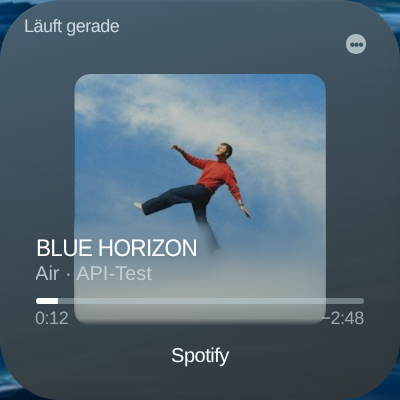
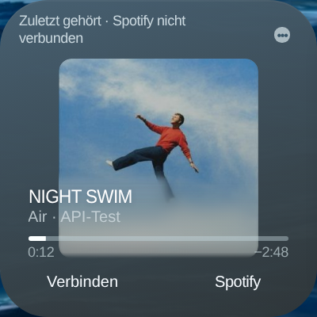
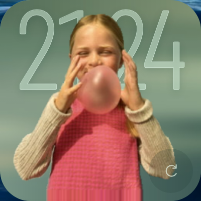
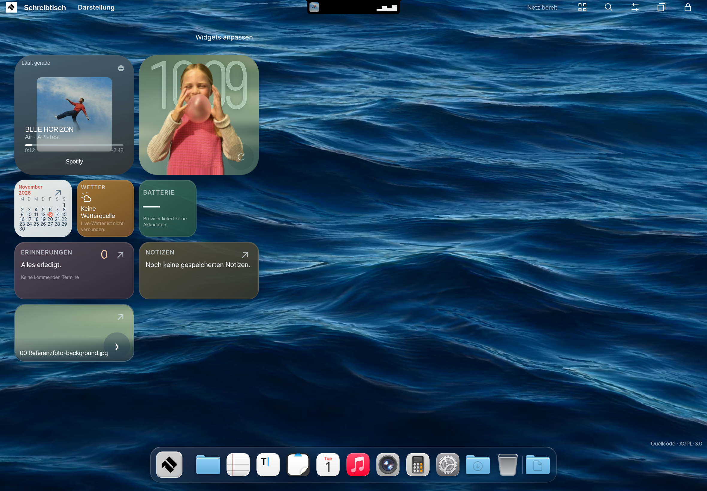
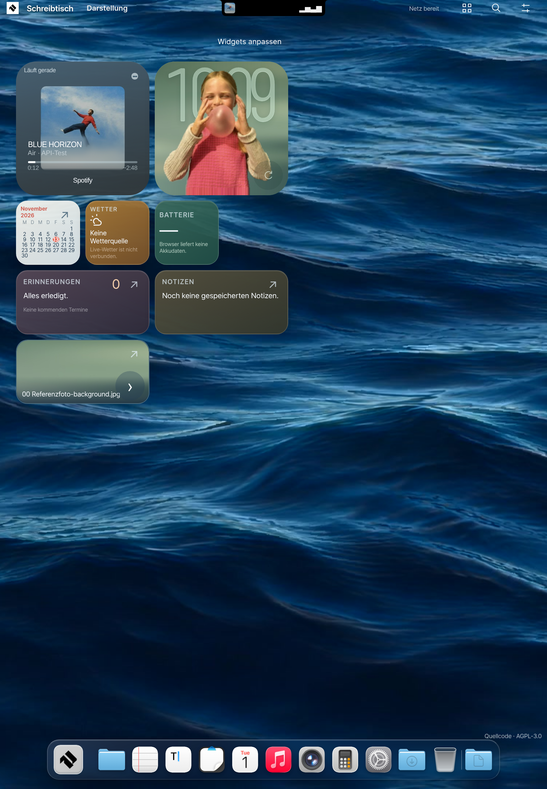
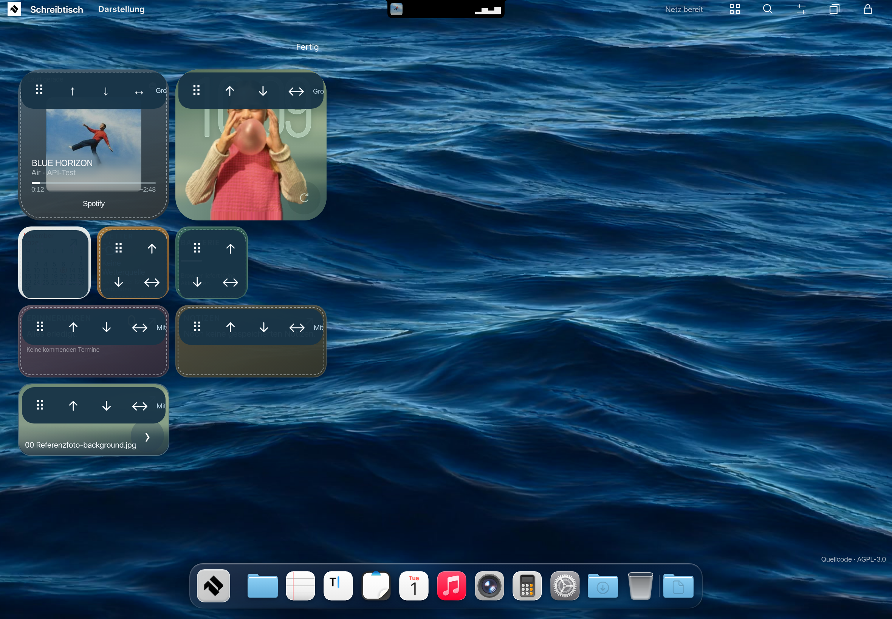
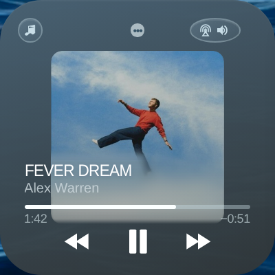
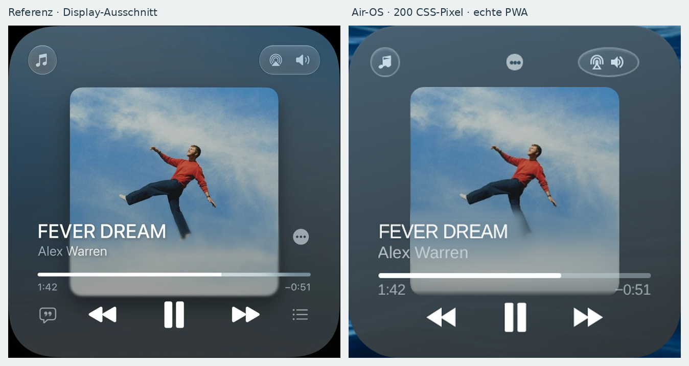
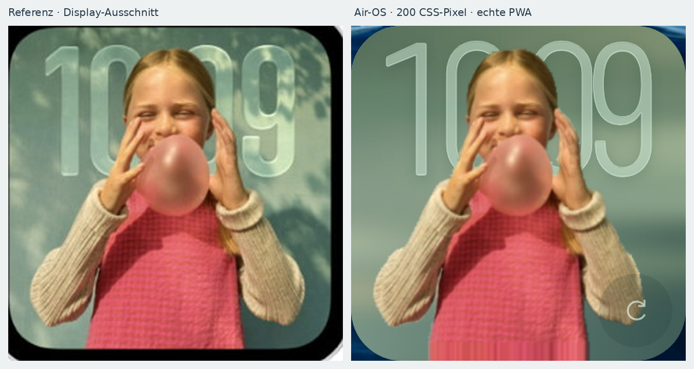
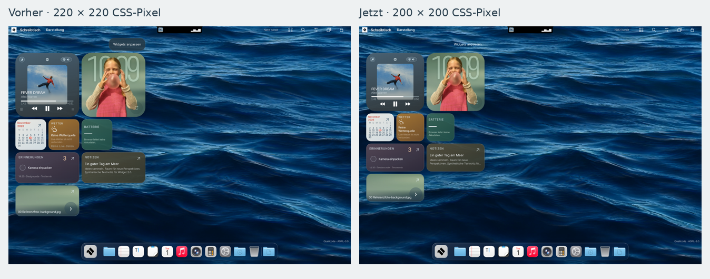

# Widget 2.2 – echte Browseraufnahmen

Alle Bilder stammen aus der laufenden PWA. Die Einzelkarten haben **200 × 200
CSS-Pixel**; ihre PNGs sind bei **DPR 2** entsprechend 400 × 400 Bildpixel groß.
Homescreen-Viewports: 1180 × 820 und 820 × 1180 CSS-Pixel.

Das Profil enthält synthetische Spotify-API-Daten und native synthetische
WAV-Dateien. Cover und Foto sind die bereits bereitgestellten Referenzmedien.
Die Testuhr 10:09 dient dem reproduzierbaren Vergleich. In der Anwendung liest
die Uhr `Date` und die lokale Browser-Zeitzone. `clock-system-local.png` zeigt
separat die lokale Browserzeit zum Aufnahmezeitpunkt. Kein Bild ist ein
KI-Mockup oder eine ausgetauschte UI-Ebene.

## Spotify als bevorzugte Quelle

Spotify bleibt entsprechend der vorhandenen OAuth-Berechtigungen lesend.
Der Link öffnet Spotify; zusätzliche Verbindungs-/Leseaktionen stehen im Menü.
Lokale Transporttasten werden nicht als Spotify-Steuerung angezeigt.

## Uhr, Homescreen und Textaktion

## Weiterhin funktionsfähiges Air Music

Die normierten Vergleichsbilder zeigen Proportionen; sie behaupten keine
vollständige Pixelidentität. Eigene Symbole, Schrift und die notwendigen
44-Pixel-Touchflächen erzeugen Restunterschiede. Fünf 44-Pixel-Tasten benötigen
220 Pixel; bei 200 bleiben drei direkte Transporttasten, Menü und Bibliothekszugriff.
Die Rohaufnahmen und alle älteren 2.1-Bilder bleiben erhalten.

## Reproduktion und Grenzen

`npm run test:widgets-22` schreibt Aufnahmen und Prüfbericht standardmäßig nach
`dist/widgets-22-<engine>`. `WIDGETS22_OUTPUT` wählt ein anderes Ausgabeziel.
Der lokale Referenzplayer wird mit `scripts/capture-ipad-widgets-21.cjs` und
`WIDGETS21_OUTPUT=docs/testing/widgets-2-2/air-music` aufgenommen. Anschließend
erzeugt `python3 scripts/compare-widgets-22.py` die Vergleichspanels.

`report.json` enthält echte Touch-Rechtecke, Tastatur-/Zeit-/Datenschutzprüfungen,
Styles der Textaktion und SHA-256-Werte der zugehörigen Widget-Dateien.
`air-music/geometry.json` dokumentiert die Referenzpositionen im echten DOM.
Der vollständige CI-Endstatus wird in PR #9 verlinkt. Linux-Browserprüfungen mit
simulierten autorisierten Endpunkten ersetzen keinen Kontotest und keinen Test
auf einem physischen iPad. Es gibt keine 60-FPS-Garantie.
